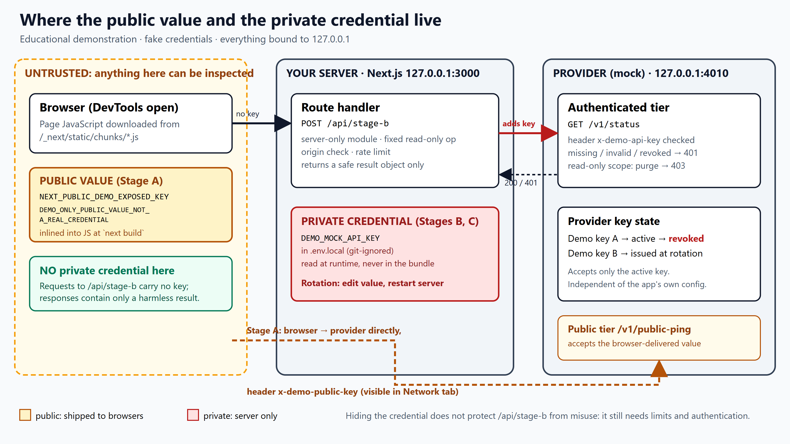

# Architecture

Source: [docs/architecture.svg](docs/architecture.svg) (editable). The same diagram exists as native, editable shapes on slide 2 of `presentation/secret_key_leak_demo.pptx`.

## Components

| Component | Address | Holds |
|---|---|---|
| Browser | user's machine | The **public value** (inlined into `/_next/static/chunks/*.js`). Never the private credential |
| Next.js server (`next start`) | `127.0.0.1:3000` | The **private credential** `DEMO_MOCK_API_KEY` from `.env.local`; route `POST /api/stage-b` |
| Mock API (`mock-api/server.mjs`) | `127.0.0.1:4010` | Its **own** key state: Demo key A active, then revoked; Demo key B issued at rotation |

## Request flows

1. **Stage A (browser → mock public tier).** `GET /v1/public-ping` with `x-demo-public-key: <public value>`. CORS is allowed only for `127.0.0.1:3000` and `localhost:3000`. The value is visible in the request and in the JavaScript file.
2. **Stage B/C (browser → route → mock API).** `POST /api/stage-b` with no credential. The route checks origin and rate limit, then `GET /v1/status` with `x-demo-api-key: <private credential>`. It returns `{ ok, message, upstreamStatus, reason?, providerKeyLabel?, configuredKeyLabel }`: labels such as "Demo key A", never the key.
3. **Provider controls (demo only).** `POST /admin/rotate`, `/admin/reset`, `GET /admin/latest-key`, `/admin/state`, and an HTML `/console`. The in-app **Rotate key** button goes through `POST /api/demo/rotate`, which drops the new key from the response before it reaches the browser.

## Why the mock's accepted key is independent of the app's config
The mock keeps its own `generation` counter and derives `DEMO_KEY_<A|B|…>_FAKE_MOCK_ONLY_NOT_A_REAL_CREDENTIAL` itself; it never reads the Next.js environment. Rotation therefore changes provider acceptance without touching the app, so the unchanged app genuinely fails until its configuration is updated and it is restarted.

## Boundaries and safeguards (and their limits)

| Safeguard | What it does | What it does not do |
|---|---|---|
| No `NEXT_PUBLIC_` prefix | Keeps the value out of the browser bundle | Cannot stop a developer from returning it in a response or from adding it to `next.config` `env` |
| `import "server-only"` in `lib/server/*` | Build fails if a Client Component imports the credential module | Does not review what server code sends out |
| Safe result object | Response is built field by field; no headers, bodies or keys echoed | Depends on discipline when the route is edited |
| Origin check | Refuses requests made from another website's page | A script can forge headers; it is not authentication |
| Rate limit (30/min, in-memory) | Limits how fast the server's key can be spent | Per process; not per user |
| Read-only key scope | Mock refuses `purge` with `403 insufficient_scope` | Real scopes depend on the provider |
| Logging | Server logs only the upstream HTTP status | Other logging added later could leak |

`npm run verify` and `npm run scan` check the build and responses for the fake keys; the checks include a planted-leak negative control so a "none found" result is meaningful.
