# Backup walkthrough

Use this if the live demo cannot run. Screenshots were captured from the real production build by `npm run screenshots` (panels 03, 05, 09, 11 render captured real data: the served JS excerpt, the browser's network events, and command output). Educational demonstration: all credentials are fake and local.

See [DEMO_RUNBOOK.md](DEMO_RUNBOOK.md) for the live procedure and [SPEAKER_NOTES.md](SPEAKER_NOTES.md) for the script.

## 1. Start state  `0:00`

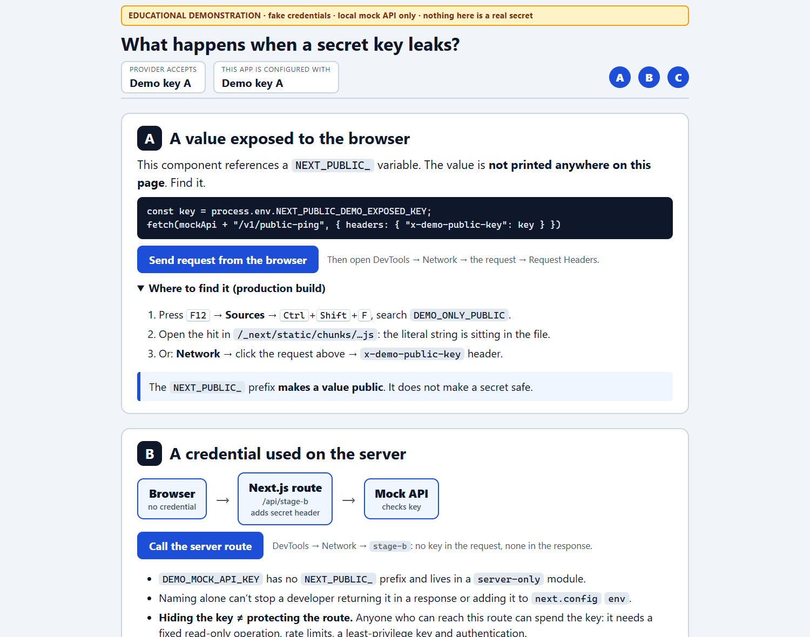

Banner marks this as an educational demonstration. Provider accepts Demo key A; the app is configured with Demo key A.

**Say:** Both services are local; keys are fake.

## 2. Stage A: browser sends a value  `0:20`

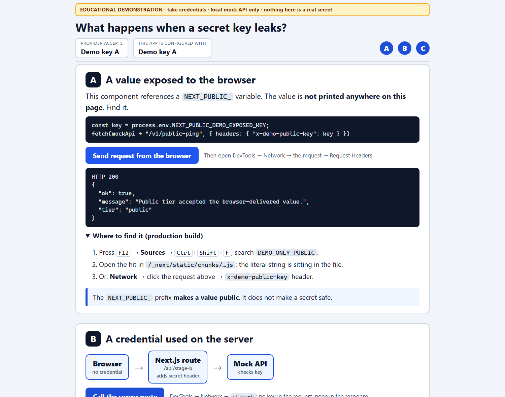

The component's NEXT_PUBLIC_ value is not printed on the page, but the browser sends it in a request header. The mock public tier accepts it (HTTP 200).

**Say:** Anything the browser sends, the user can read.

## 3. Stage A: the value is in the JavaScript file  `0:45`

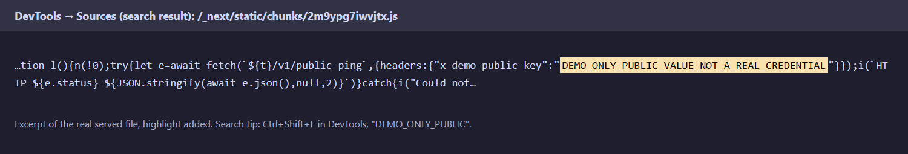

Searching the production chunk for DEMO_ONLY_PUBLIC finds the literal string. Next.js inlined it at build time.

**Say:** NEXT_PUBLIC_ makes a value public; it does not make a secret safe.

## 4. Stage B: server route succeeds  `1:10`

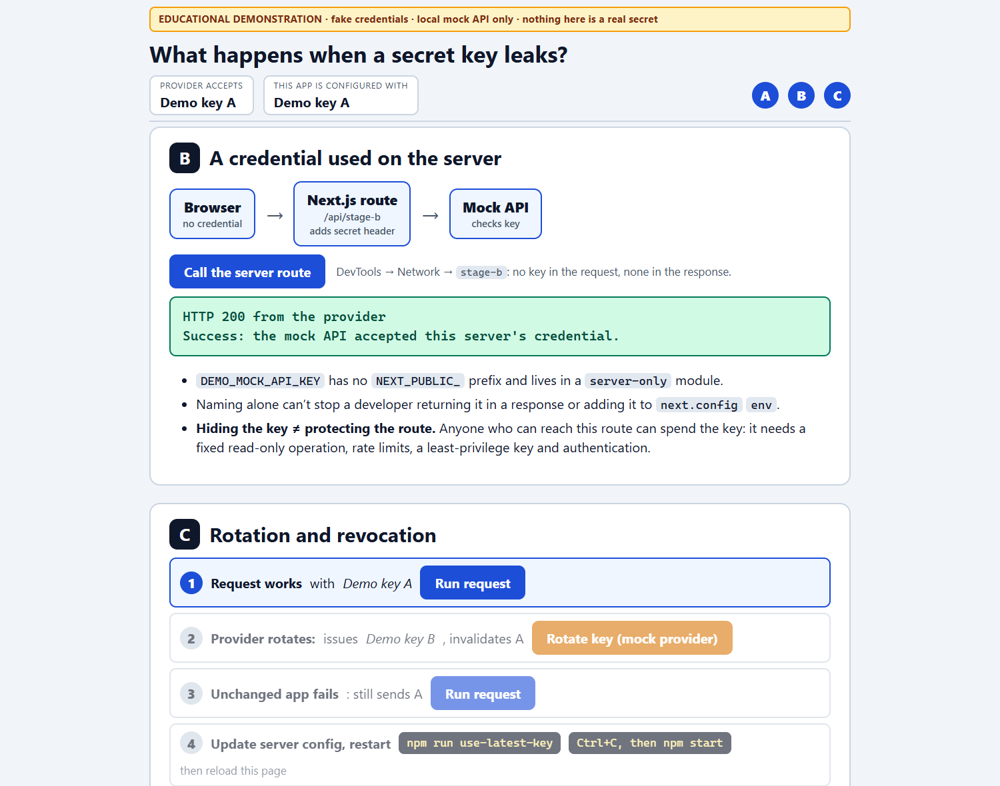

The browser called /api/stage-b. The server added the credential and the mock API accepted it. The browser only sees a harmless result.

**Say:** A server can use a credential without handing it to the browser.

## 5. Stage B: nothing secret on the wire to the browser  `1:35`

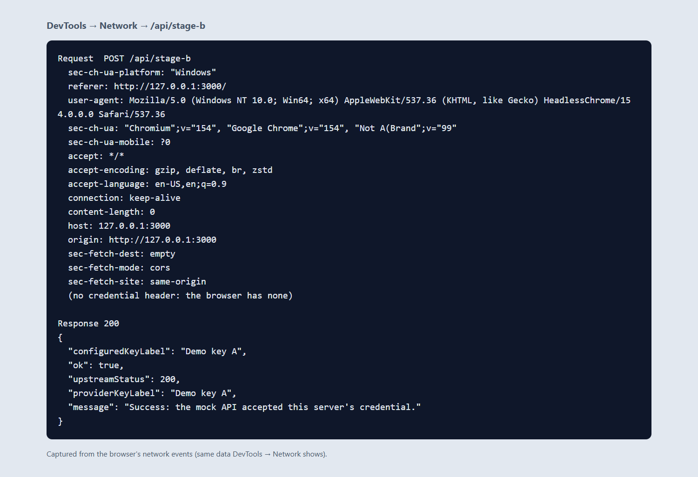

The request carries no credential header; the response has only labels and a message.

**Say:** Naming alone cannot stop a developer returning a secret; hiding the key does not protect the route (limits, least privilege, authentication).

## 6. Stage C 1: request works with Demo key A  `2:00`

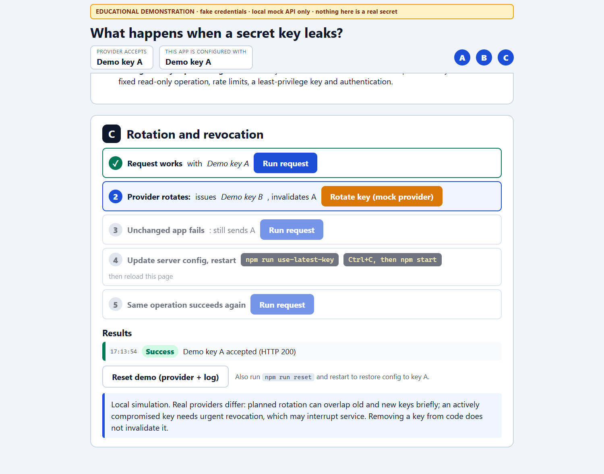

First entry in the results list: Success.

**Say:** Baseline.

## 7. Stage C 2: provider rotates  `2:15`

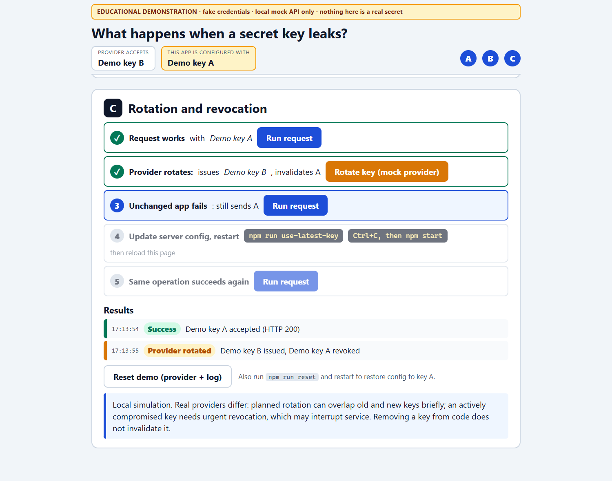

The provider issues Demo key B and revokes Demo key A. The status strip now shows a mismatch: provider accepts B, app still has A.

**Say:** Rotation changes what the provider accepts first.

## 8. Stage C 3: unchanged app is rejected  `2:30`

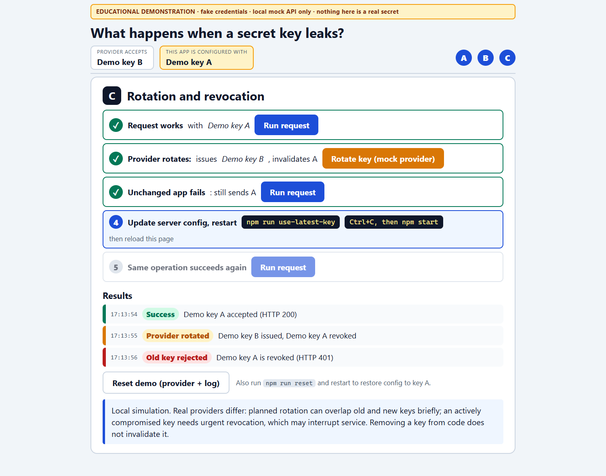

Same app, same code: HTTP 401, old key rejected.

**Say:** Removing a key from code does not invalidate it; only the provider can.

## 9. Stage C 4: update configuration and restart  `2:45`

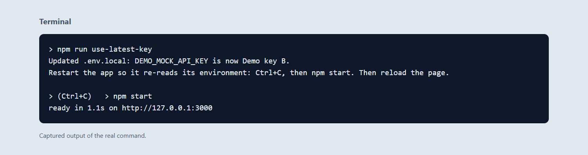

npm run use-latest-key writes Demo key B into .env.local; the server is restarted so it re-reads its environment.

**Say:** Rotation must update both the provider and the application's configuration.

## 10. Stage C 5: success restored  `3:10`

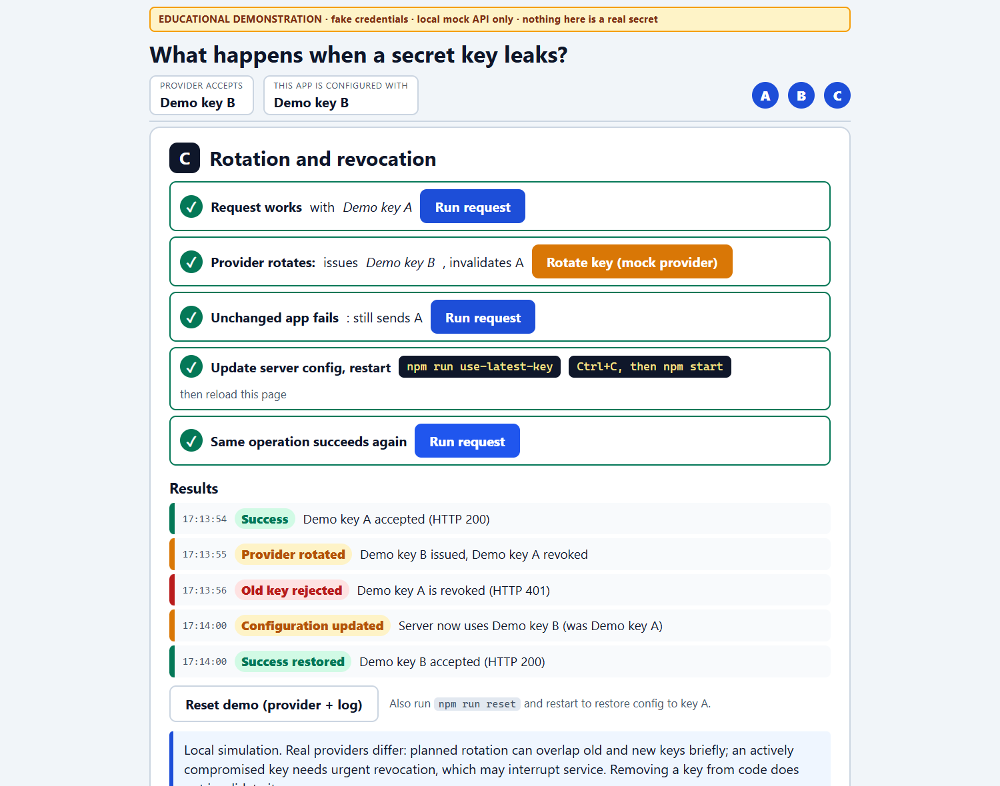

After reload the status strip reads Demo key B. Results: Configuration updated, then Success restored.

**Say:** Planned rotation can overlap keys; a compromised key needs urgent revocation and may interrupt service.

## 11. Reset  `after`

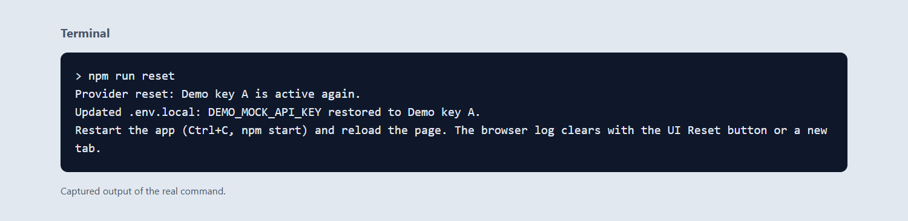

npm run reset restores Demo key A at the provider and in .env.local; restart the app to repeat the demo.

**Say:** The demo is repeatable.

## 12. Optional: provider console  `optional`

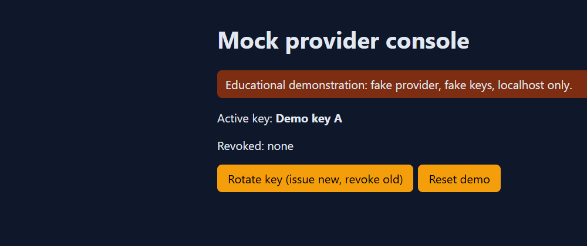

http://127.0.0.1:4010/console shows the active and revoked keys and lets you rotate or reset; a new key is shown once, like a real dashboard.

**Say:** Manual alternative for the rotate and config steps.
